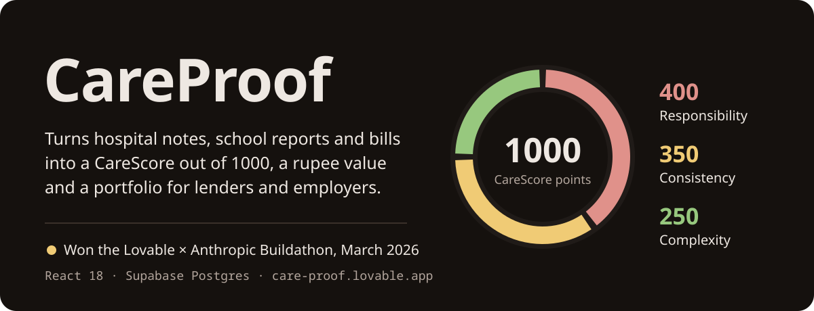
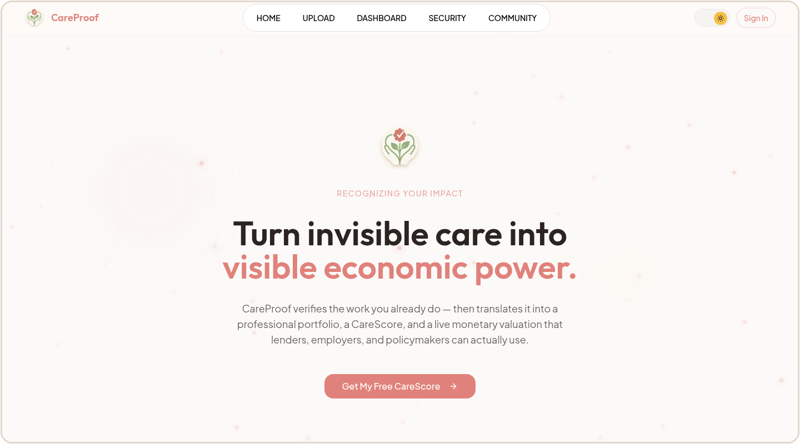

<p align="center">
  
</p>

<p align="center">
  <a href="https://care-proof.lovable.app"><strong>Open the live app</strong></a> ·
  <a href="#how-the-carescore-is-calculated">How the score is calculated</a> ·
  <a href="#run-it-locally">Run it locally</a>
</p>

<picture>
  <source media="(prefers-color-scheme: dark)" srcset="./assets/readme/live-landing-dark.png">
  
</picture>

<sub>This is the landing page you'll see at care-proof.lovable.app, in whichever theme your GitHub uses. Sign in with Google and you get the upload flow and the dashboard.</sub>

## What it does

If you look after an ageing parent or a sick child, you're putting in hours of skilled work every week, and none of it shows up on your CV or a loan application. CareProof takes the papers that work leaves behind (a discharge summary, a school report card, an electricity bill) and turns them into numbers someone else can check. A bank can read a score out of 1000. It can't read a career gap.

You upload a file (PDF, JPG, PNG, WEBP or HEIC, up to 10 MB), check the care entry CareProof reads from it, and save it. The database then recalculates everything in this table:

| Output | What you see | Where it is stored |
|---|---|---|
| CareScore | A number from 0 to 1000 on the dashboard gauge | `care_scores`, written by a trigger |
| Economic value | Daily, monthly and lifetime value in rupees | `care_valuations`, hours × ₹450 |
| Portfolio | Your entries as a printable page of skills and tenure | built from `care_entries`, printed from the browser |
| Community stats | Caregiver count, total hours and total value across the platform | `community_stats`, readable by anyone |

Each upload becomes one row in `care_entries` (activity, date, hours, skills, care type, evidence file). The file itself goes to a private storage bucket, `care-evidence`, in a folder named after your user id.

## How the CareScore is calculated

<p align="center">
  
</p>

Your score is computed in Postgres, not in the browser. There's no backend code. Every time you add, edit or delete an entry, the trigger `recalculate_user_metrics()` rebuilds your score and value from all of your entries in `care_entries`:

| Part | Rule | Cap |
|---|---|---|
| Responsibility | total hours × 1.8, rounded down | 400 |
| Consistency | distinct months with at least one entry × 45 | 350 |
| Complexity | distinct skills across all entries × 20 | 250 |

The value uses the replacement cost method: what you'd have to pay someone else for the same hours. The rate's ₹450 an hour (`v_hourly_rate` in the migration). Monthly value is lifetime value divided by the months you've been active; daily value divides by active days.

**Current limit:** the upload step doesn't read what's inside the file yet. `src/services/documentAnalysis.ts` matches the file name against 8 patterns (`discharge`, `school`, `bill`, `therapy`, `pharmacy` and others), takes the first match, and falls back to a generic 2-hour entry. A photo named `IMG_2041.jpg` is logged as 2 hours of Caregiving Support Activity. The example above uses those exact rules, so you can reproduce it. [Swapping in a real parser](#plugging-in-real-document-parsing) means replacing one function.

## Run it locally

You'll need [Node.js](https://nodejs.org/) 18 or newer and a [Supabase](https://supabase.com) project with Google sign-in turned on.

**1. Clone and install**

```bash
git clone https://github.com/https-shubhamsahu/care-proof.git
cd care-proof
npm install
```

**2. Add your Supabase keys.** Copy `.env.example` to `.env` and fill in the values from Supabase → **Settings → API**:

```env
VITE_SUPABASE_URL=https://your-project.supabase.co
VITE_SUPABASE_PUBLISHABLE_KEY=your-anon-public-key
VITE_SUPABASE_PROJECT_ID=your-project-id
```

**3. Create the database.** In Supabase → **SQL Editor**, paste and run `supabase/migrations/20260308_initial_schema.sql`. It creates the four tables, the row-level security policies, the trigger and the storage bucket.

**4. Turn on Google sign-in.** In Supabase → **Authentication → Providers → Google**, enable Google, paste your Google OAuth credentials, and add `http://localhost:5173` to the allowed redirect URLs.

> Deploying through Lovable? The `@lovable.dev/cloud-auth-js` proxy handles the OAuth redirect for you.

**5. Start the dev server**

```bash
npm run dev
```

Then open [http://localhost:5173](http://localhost:5173).

### Scripts

| Command | What it does |
|---|---|
| `npm run dev` | Vite dev server with hot reload |
| `npm run build` | Production build |
| `npm run build:dev` | Build in development mode |
| `npm run preview` | Serve the production build locally |
| `npm run lint` | ESLint with the TypeScript rules |
| `npm run test` | Run the Vitest tests once |
| `npm run test:watch` | Run the tests in watch mode |

### Routes

| Route | Access | Page |
|---|---|---|
| `/` | Public | Landing page: how it works, features, FAQ |
| `/auth` | Public | Google sign-in |
| `/upload` | Signed in | Upload a document, review the parsed entry, save it |
| `/dashboard` | Signed in | CareScore gauge, economic value, timeline, portfolio |
| `/future-security` | Signed in | Lifetime value, transferable skills, career readiness |
| `/community` | Signed in | Platform-wide stats, caregiver spotlight, 3D globe |

## Plugging in real document parsing

`Upload.tsx` only cares about the shape `analyseDocument(file)` returns, so you can swap the file-name rules for a real AI or OCR call without touching anything else. Open `src/services/documentAnalysis.ts` and replace the body:

```typescript
// Example: send the file to your own endpoint (Gemini Vision, Textract, ...)
export async function analyseDocument(file: File): Promise<ExtractedEntryWithDate> {
  const formData = new FormData();
  formData.append("file", file);

  const res = await fetch("/api/analyse", { method: "POST", body: formData });
  const data = await res.json();

  return {
    activity: data.activity,
    date: data.date,           // display date string
    isoDate: data.isoDate,     // YYYY-MM-DD
    hours: data.hoursLabel,
    hoursValue: data.hours,
    skills: data.skills,
    careType: data.careType,
  };
}
```

## Security

- Row-level security is on for all four tables. You can only read and write your own entries, score and valuation; `community_stats` is the one table anyone can read.
- Evidence files live in the private `care-evidence` bucket, and storage policies only let you upload, view and delete files inside your own folder.
- Sign-in is Google OAuth through Supabase Auth.
- Your keys belong in a local `.env`; start from `.env.example`.

<details>
<summary><strong>Project layout and stack</strong></summary>

```
care-proof/
├── src/
│   ├── pages/               # Route-level pages (Index, Auth, Upload, Dashboard, ...)
│   ├── components/          # App components + shadcn/ui library
│   │   └── ui/              # shadcn/ui primitives
│   ├── hooks/
│   │   └── useCareData.ts   # All Supabase queries (react-query)
│   ├── services/
│   │   └── documentAnalysis.ts  # Document classifier (AI integration point)
│   ├── integrations/
│   │   ├── supabase/        # Supabase client + TypeScript types
│   │   └── lovable/         # Lovable OAuth proxy
│   └── index.css            # Design tokens + Tailwind
├── supabase/
│   └── migrations/          # SQL migration (run in the Supabase SQL editor)
└── public/                  # Static assets
```

| Layer | Technology |
|---|---|
| Framework | Vite + React 18 + TypeScript |
| Styling | Tailwind CSS v3 + CSS custom properties |
| UI components | shadcn/ui (Radix UI primitives) |
| Animation | Framer Motion |
| 3D globe | Three.js via @react-three/fiber + @react-three/drei |
| Auth | Supabase Auth + Google OAuth |
| Database | Supabase (PostgreSQL) |
| State and cache | @tanstack/react-query |
| Routing | react-router-dom v6 |
| Forms | react-hook-form + zod |
| Typography | Outfit (headings) + Plus Jakarta Sans (body) |

</details>

<details>
<summary><strong>Design tokens</strong></summary>

The three brand colours are HSL custom properties in `src/index.css`, each with a light and a dark value.

| Token | Light | Dark | Used for |
|---|---|---|---|
| `--primary` / `--terracotta` | `4 62% 68%` | `4 55% 72%` | Brand, buttons, the CareScore gauge |
| `--gold` | `42 90% 62%` | `42 80% 70%` | Rupee values |
| `--verified` | `100 38% 56%` | `100 40% 64%` | Verification badges |

```css
.glass-card       /* Frosted card with backdrop-blur */
.glow-primary     /* Terracotta ambient glow */
.glow-gold        /* Gold ambient glow */
.glow-verified    /* Sage green ambient glow */
.text-gradient-primary / .text-gradient-gold / .text-gradient-verified
.font-heading     /* Outfit typeface */
```

`scripts/build_readme_assets.py` draws the README graphics from the dark values, so if you change a token, rerun it.

</details>

## Roadmap

- [ ] Real AI document parsing (Gemini Vision or AWS Textract)
- [ ] PDF portfolio export (react-pdf or server-side Puppeteer)
- [ ] Shareable portfolio links with per-link access control
- [ ] Email notifications when a care entry is verified
- [ ] Recurring care templates (for example "Daily elder care, 2 hrs")
- [ ] Hindi, Tamil and Telugu
- [ ] Lender API: a standard format for partner banks and NBFCs
- [ ] Progressive Web App (offline uploads, mobile camera)

## Contributing

1. Fork the repository
2. Create a feature branch: `git checkout -b feat/my-feature`
3. Commit your changes: `git commit -m "feat: add my feature"`
4. Push to the branch: `git push origin feat/my-feature`
5. Open a pull request

Please follow the existing code style: strict TypeScript, Tailwind classes over inline styles, react-query for all async data.

## License

No `LICENSE` file is currently present in this repository. Add one (e.g. MIT) to make usage terms explicit.

---

Questions: [shubhamsahu@nosus.foo](mailto:shubhamsahu@nosus.foo)
